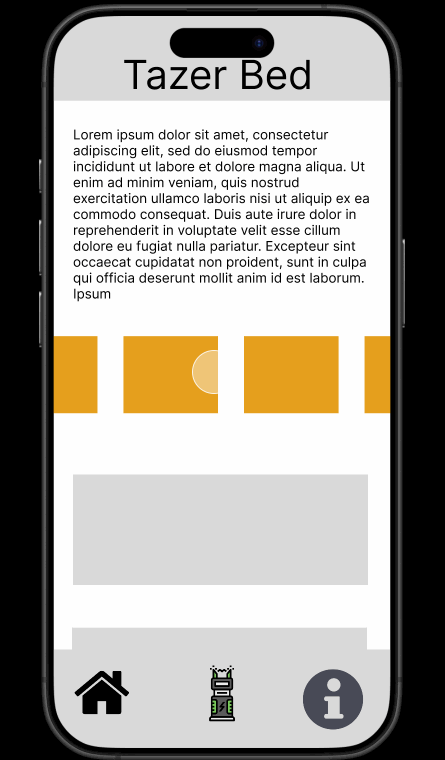
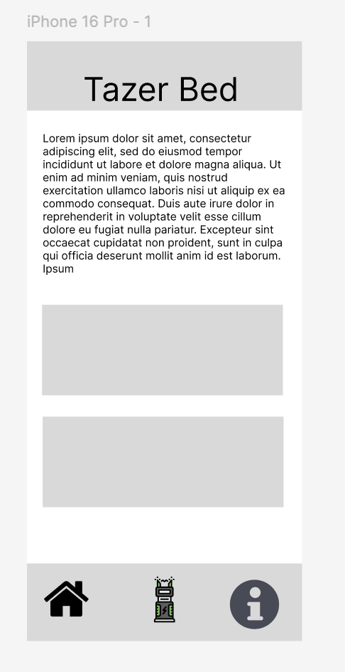
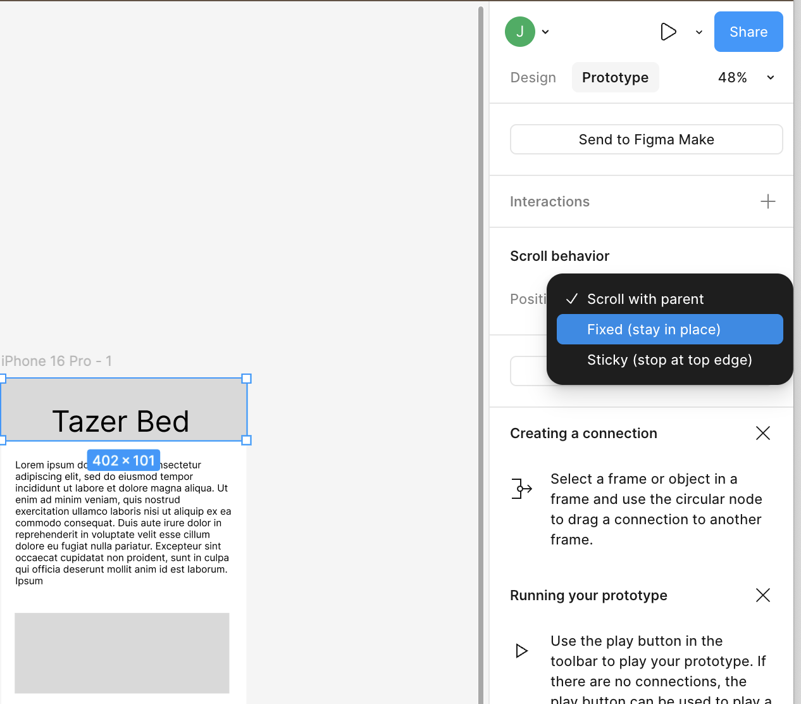
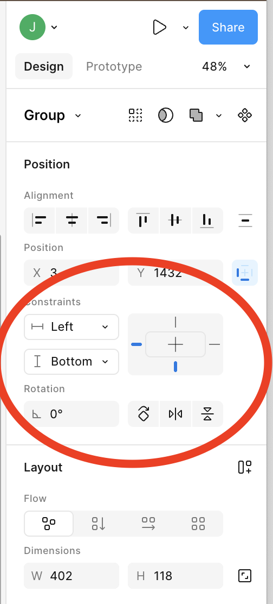
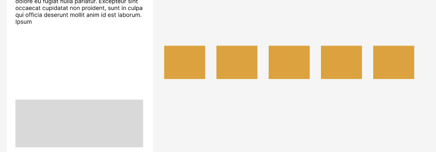
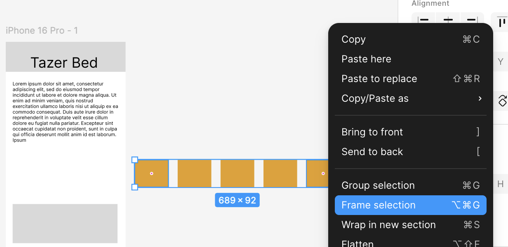
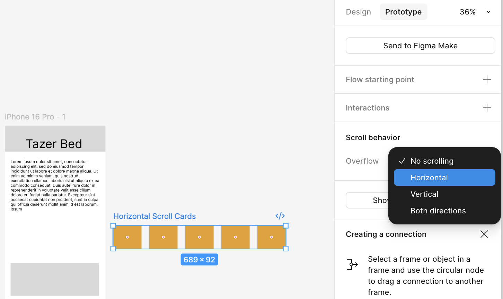
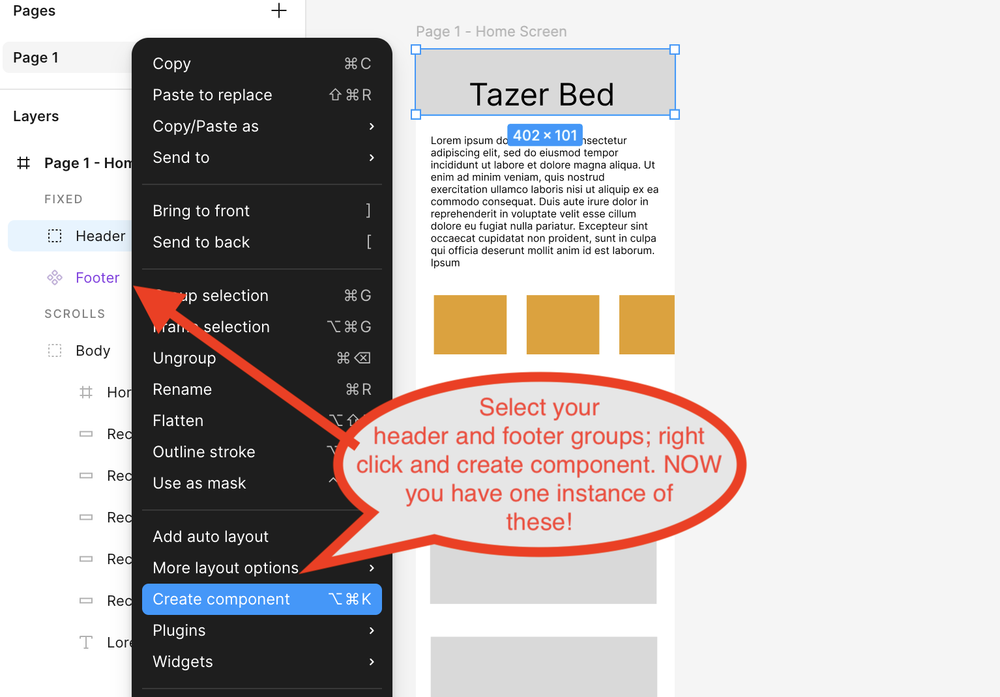
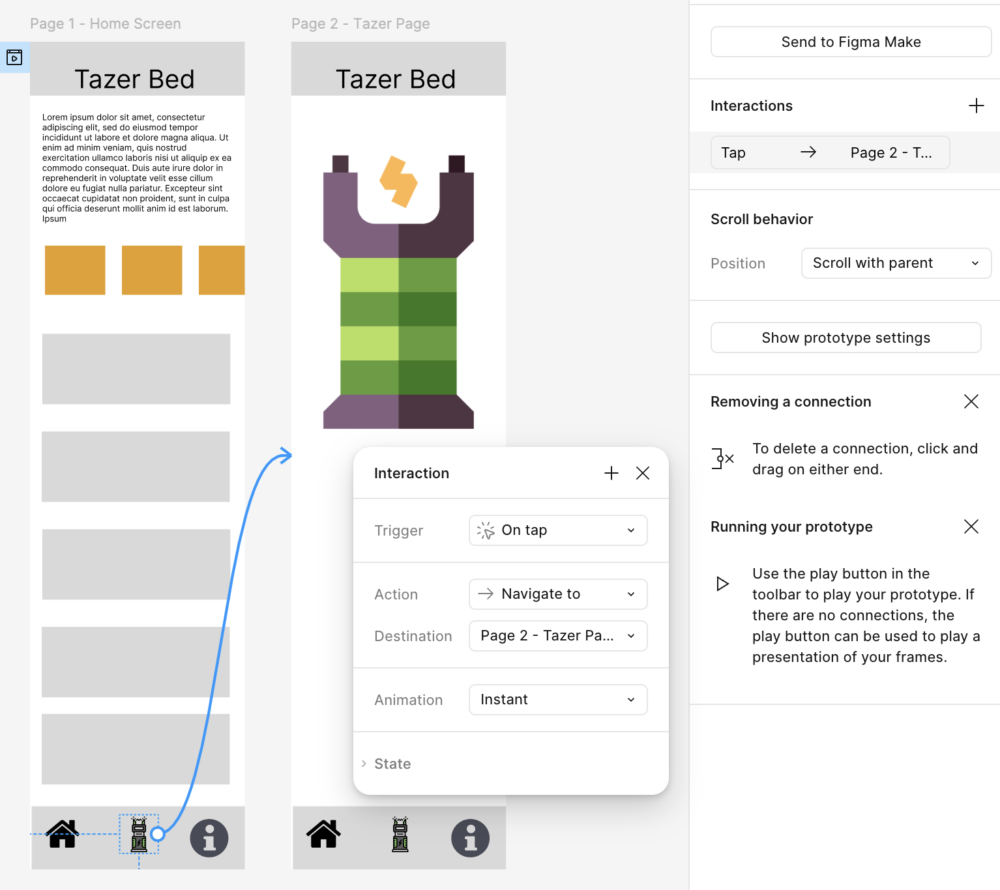

# Figma Prototyping Walkthrough: Tazer Bed Guide

> This is a step-by-step companion to the [Figma Prototyping Exercise](figma-prototyping-exercise.md). It covers the same four interaction patterns as the [YouTube tutorial](https://www.youtube.com/watch?v=v1UKB-0EUhQ) but uses a themed example: a fictional product called "Tazer Bed" from an IGME 110 project.
>
> **The Figma techniques are identical.** If you'd rather follow the video and build a generic app, go for it. This guide is here if you prefer written steps with screenshots, or want a reference to come back to when you get stuck.

**Time:** 45 to 60 minutes the first time. Once you know it, about five.

**What you need:** A Figma account (Education plan recommended: [setup instructions](https://docs.google.com/document/d/1nlwsaJXJozfZu4VocByOHxetIghnsTwGtABZgRNFOCc/edit?usp=sharing))

## What you'll build

A clickable phone prototype that scrolls up and down, has a row of cards that scrolls sideways, moves
between two pages, and opens a pop-up.

---

## Part 1: The basic screen

### Step 1: Create a file and a phone frame

1. Create a new Figma **Design** file and name it "Prototype Practice."
2. Press `F` to make a frame.
3. In the right panel, pick a phone size that matches your phone (iPhone 16 Pro, Pixel 8, and so on).

Picking your real phone size now means the preview will match your screen later.

### Step 2: Build the header

1. Press `R` and draw a rectangle across the top of the frame.
2. Change its fill to a dark gray (something like `#333333`).
3. Press `T` and add text on top of it: "Tazer Bed" or whatever you like.
4. Make the text white and center it.

This is a wireframe, so don't spend long on styling.

### Step 3: Build the tab bar

1. Copy the header rectangle (`Cmd/Ctrl + C`, then `Cmd/Ctrl + V`) and move it to the bottom of the
   frame.
2. Press `R` and draw 3 small rectangles on it. These stand in for icons.
3. Space them evenly.

Keep the tab bar about 60 to 80 pixels tall.

### Step 4: Add content cards

1. Press `R` and draw a card between the header and the tab bar.
2. Copy and paste it so you have 3 cards, stacked with a little space between them (about 16 to 20
   pixels).

### Step 5: Play it, and get a link

1. Click the **Prototype** tab at the top of the right panel.
2. Set the device to your phone.
3. Select the frame and click the **Play** button (the triangle, top right).
4. Click **Share prototype** to get a link anyone can open.

It doesn't do anything yet, but it's a real prototype.

### ✅ Checkpoint: the basic screen

A phone frame with a dark header, 3 cards, and a tab bar with 3 icon placeholders.

---

## Part 2: Scrolling

### Step 6: Make the page scroll

1. Zoom out a bit and select the frame.
2. Drag the **bottom edge** of the frame down to make it taller than the phone.
3. Drag the tab bar down to the new bottom.
4. Copy a card and paste more of them to fill the extra space.

Play it: the page should scroll now. You'll notice the header and tab bar scroll away with
everything else. The next two steps fix that.

**Doesn't scroll?** Select the frame, then **Prototype** tab → **Scroll behavior** → **Overflow** →
**Vertical**.

### Step 7: Keep the header in place

1. Select the header rectangle and its text, then group them (`Cmd/Ctrl + G`).
2. With the group selected, go to the **Prototype** tab → **Scroll behavior** → **Position** and
   choose **Fixed (stay in place)**.

The header now stays at the top while the cards scroll under it.

**Can't find Position?** Check that the page frame scrolls (step 6). And check you're not in **Draw
mode**: if the right panel looks empty or strange, switch back to **Design** mode at the bottom right
of the toolbar.

### Step 8: Keep the tab bar in place

1. Select the tab bar and its icons, and group them.
2. In the **Design** tab, find **Constraints** under Position and set the vertical one to **Bottom**.
3. Then, same as the header: **Prototype** tab → **Scroll behavior** → **Position** → **Fixed (stay
   in place)**.

The bottom constraint is the step people miss. Without it, the tab bar stays fixed in the wrong spot.

### ✅ Checkpoint: scrolling

Play it. The page scrolls, the header stays at the top, the tab bar stays at the bottom, and the
cards scroll between them.

### Step 9: Make a row of cards for sideways scrolling

1. Make the first card narrower, about 60 to 70 percent of the frame's width.
2. Copy and paste it into a row of several cards, **side by side**.
3. Select the whole row and drag it **out of the phone frame** for now.

They need their own frame before they can scroll, and that's easier to set up outside the phone.

### Step 10: Put the row in its own frame

1. With the cards selected, right-click → **Frame selection**.
2. Drag that new frame back into the phone frame, where you want the row.

### Step 11: Turn on sideways scrolling

1. Select the **cards frame** (the container, not one card).
2. Make it the width of the phone, so the cards run off the right edge.
3. In the **Design** tab, check **Clip content** so the extra cards are hidden.
4. In the **Prototype** tab → **Scroll behavior** → **Overflow**, choose **Horizontal**.

The frame has to be narrower than the row of cards. If everything fits, there's nothing to scroll.

### ✅ Checkpoint: sideways scrolling

Play it. The page still scrolls up and down with the header and tab bar fixed, and the row of cards
scrolls sideways.

### Step 11.5: Make the header and tab bar into components (recommended)

Do this before you copy the page in the next step.

1. Select the header group, then right-click → **Create component**.
2. Do the same for the tab bar group.

Now when you copy the page, the header and tab bar come along as **instances** of those components.
Change the original once and every copy updates. Anything that repeats across screens should be a
component; it's a habit worth building now.

---

## Part 3: A second page

### Step 12: Make page 2

1. Double-click the frame's name and rename it **Page 1**.
2. Copy the whole frame and paste the copy beside it. Rename it **Page 2**.
3. Keep the header and tab bar, and change the rest so it clearly looks like a different screen.

If Page 2 looks too much like Page 1, you won't be able to tell when the link works.

### Step 13: Link Page 1 to Page 2

1. Make sure the **Prototype** tab is selected.
2. On Page 1, select one of the tab bar icons.
3. Hover over it until a small blue circle appears on its edge.
4. Drag that circle onto Page 2 and let go.

Tapping that icon now goes to Page 2. Be sure to drag the blue circle, not the icon itself; it's a
small target.

### Step 14: Link back to Page 1

1. On Page 2, select a **different** icon in the tab bar.
2. Drag its blue circle to Page 1.

**Another way to make a link:** select the icon, click **+** next to **Interactions** in the
Prototype tab, change the action to **Navigate to**, and pick the page. Same result. This way is
easier once a screen has a lot of links.

### ✅ Checkpoint: pages

Play it. The tab bar icons take you back and forth between the two pages.

---

## Part 4: A pop-up

### Step 15: Make the pop-up

1. Press `F` and make a frame **smaller than the phone**, about 70 to 80 percent as wide. Put it next
   to your pages, not on them.
2. Inside it, add a background rectangle, a close button (an X) in the top right corner, and some
   content.

It should be clearly smaller than the screen, so it reads as a pop-up and not a new page.

### Step 16: Open it from a page

1. On Page 2, select the icon or button that should open the pop-up.
2. In the **Prototype** tab, drag its blue circle to the pop-up frame.
3. In the interaction settings, change **Navigate to** to **Open overlay**.
4. Check **Add background behind overlay** (dims the page) and **Close when clicking outside**.

### Step 17: Make the X close it

1. Select the X in the pop-up.
2. Click **+** next to **Interactions** and set the action to **Close overlay**.

Now there are two ways to close it: the X, or tapping outside. Always give people both.

### ✅ Checkpoint: pop-up

Play it. The trigger opens the pop-up over a dimmed page, and both the X and a tap outside close it.

---

## Bonus tips

### Put the tab bar's links inside the component

If you did step 11.5, you can set the tab bar's links **once** and have every page get them.

1. Find the **main component** for the tab bar (the original, not a copy; its icon in the Layers panel
   is solid).
2. Add the navigation links to its icons there: icon 1 → Page 1, icon 2 → Page 2, and so on.
3. Every copy of the tab bar on every page now has the same links. Add a page, paste in the tab bar,
   and it already works.

If you edit a copy instead of the main component, the change stays on that one page.

### Test on your phone

1. Install the **Figma** app on your phone and log in.
2. Tap **Mirror** and select a frame on your laptop.

The prototype shows up on your phone as you work. It's the best way to feel what you're building.

### Watch someone use it

Send someone your prototype link. While they're using it, open the same link yourself, hover over
the top of the screen, and click their profile picture to **follow** them: you'll see every tap as
they make it. Click **Stop following** when you're done. This is incredibly useful for user testing,
which you'll be doing for your project prototype.

---

## When something doesn't work

| Problem | Fix |
|---|---|
| The page won't scroll | Make the frame taller than the phone, and set **Overflow → Vertical** in the Prototype tab |
| The header or tab bar scrolls away | Group it, then **Prototype → Scroll behavior → Position → Fixed** |
| The tab bar is fixed in the wrong place | Set its constraint to **Bottom** in the Design tab |
| The cards won't scroll sideways | Check **Clip content**, set **Overflow → Horizontal**, and make sure the frame is narrower than the cards |
| A link doesn't work | In the Prototype tab, check there's a blue line from the icon to the page |
| The pop-up is hard to see | Turn on **Add background behind overlay** |
| The pop-up won't close | Give the X a **Close overlay** interaction |
| The right panel looks wrong | You're probably in **Draw mode**. Switch back to Design mode |

## What you've learned

These four patterns (vertical scroll, horizontal scroll, page navigation, and overlays) are the foundation of interactive prototyping. Every mobile app you use combines them in different ways. Now you know how to build them in Figma.

**Next up:** You'll apply these skills to your group's Lo-Fi Prototype (due Mon Apr 13).
